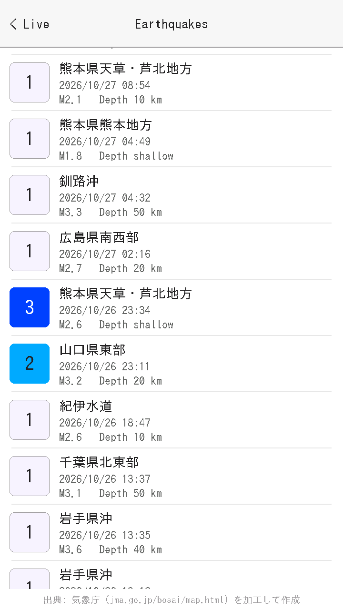
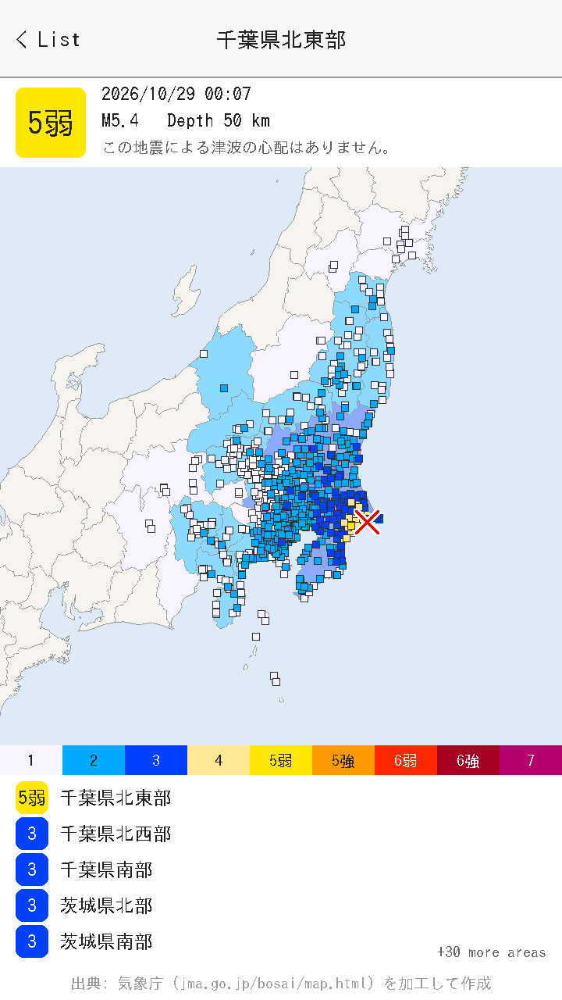
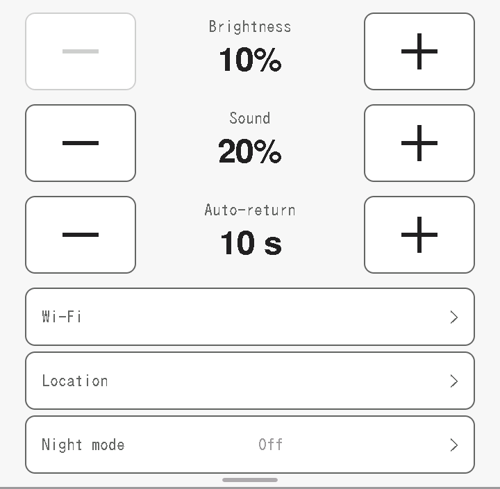

# Kyoshin Monitor for M5Stack Tab5

An always-on earthquake monitor for the [M5Stack Tab5](https://shop.m5stack.com/products/m5stack-tab5-iot-development-kit-esp32-p4),
an ESP32-P4 development kit with a 720x1280 touch screen. It shows Japan's real-time seismic map, NIED's
[強震モニタ](http://www.kmoni.bosai.go.jp/) (Kyoshin Monitor), full screen in portrait, and sounds the alarm for Earthquake Early Warnings.

The Tab5 has no browser, so the firmware rebuilds the page from the same images and data the site loads once a second.

**This is not a safety system.** It can be late, miss events or lose its connection. Don't rely on it for your safety.

## What it does

- **Live map:** the real-time map, updated every second, with early warning details and the alarm.
- **Earthquake list:** recent earthquakes from the Japan Meteorological Agency (JMA), filtered by intensity in any combination. Every earthquake of intensity 3 or stronger back to 1919 is built in.
- **Earthquake details:** a map of the affected area coloured by intensity, and the strongest regions.
- **Distance:** how far each earthquake was from a location you set.
- **Night dimming:** dims from sunset to 22:00 and brightens again towards sunrise, worked out for your location.
- **Night mode:** turns the backlight off on a schedule or all the time. A touch or an alert brings it back.
- **Wi-Fi:** pick a network and type its password on screen. Saved networks reconnect by themselves.

<table>
  <tr>
    <td></td>
    <td></td>
    <td></td>
  </tr>
</table>

The live map isn't pictured because NIED's terms don't allow republishing its images. [See it on NIED's site.](http://www.kmoni.bosai.go.jp/)
The Wi-Fi name and location are blanked out in the settings picture.

## How to use it

| To do this | Do this |
|---|---|
| Open settings | Swipe down from the top edge |
| Close settings | Swipe up, tap outside or wait 8 s |
| Open the earthquake list | Drag in from the right edge |
| Go back to the map | Swipe right, tap **< Live** or wait for Auto-return |
| Filter the list | Tap the levels along the top, or **All** to clear them |
| See an earthquake's details | Tap its row |
| Wake a dark screen | Touch it anywhere. That touch does nothing else |

Settings:

- **Brightness:** the daytime level, 10-100%.
- **Sound:** the alarm volume, Off-100%.
- **Auto-return:** how soon the list goes back to the map with no touches, Off-120 s.
- **Wi-Fi:** choose and join a network.
- **Location:** latitude and longitude, used for distances and sunrise and sunset.
- **Night mode:** Off, Scheduled or Continuous, and how long the screen stays on after a touch.

With night mode on, the backlight is off but the Tab5 keeps fetching data. An alert turns the screen on at full brightness
and sounds the alarm at the **Sound** volume. Only Earthquake Early Warning reports count as alerts, so a weak earthquake without
one won't wake it. A dark screen also won't show that the connection has been lost.

## Build and flash

You need `arduino-cli` with the `m5stack:esp32` core, and the M5Unified, M5GFX and ArduinoJson libraries.

```sh
cp kmoni_tab5/secrets.h.example kmoni_tab5/secrets.h   # then add your Wi-Fi details
echo "AA:BB:CC:DD:EE:FF" > tools/tab5_mac              # your Tab5's MAC, from: esptool read-mac
tools/flash.sh
```

Both files are gitignored. `tools/flash.sh` refuses any port whose chip doesn't report that MAC, because other M5 devices can
share the Tab5's USB IDs. The Wi-Fi password is stored unencrypted in the device's flash, as is usual on ESP32.

`test/run.sh` runs the logic tests on your computer, and the scripts in `tools/` test the device over USB. Some of them replay a
past alert, so read the note at the top of each one first. The alarm can sound at the current volume.

## Data and terms

- The live map, alarm sounds and early warning data come from NIED's Kyoshin Monitor. Keep to [NIED's terms](https://www.kyoshin.bosai.go.jp/ja/about_kmoni/): this is for private viewing. Don't republish its images or redistribute its data. This repo contains none of them, and the device downloads them while running.
- Earthquake data comes from JMA, used under [its terms](https://www.jma.go.jp/jma/kishou/info/coment.html), and has been processed for display. The source credit is shown on the earthquake pages. `tools/make_quake_snapshot.py` regenerates the built-in list.
- JMA's and NIED's data feeds aren't documented APIs, so they can change without notice.
